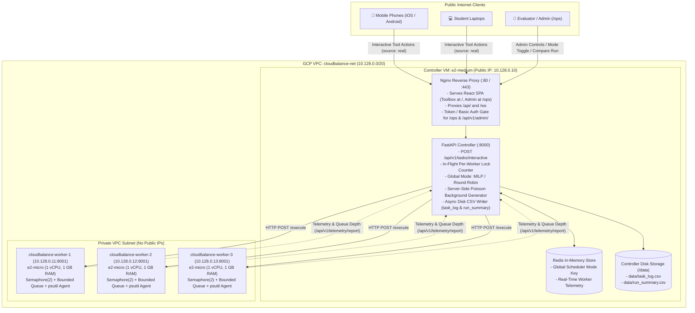

# CloudBalance — Real-World Public Platform Upgrade Plan & Task Sheet

> **Document Type:** Comprehensive Architecture Specification & Upgrade Task Sheet  
> **Target Environment:** Google Cloud Platform (GCP) — 1 Controller VM (`e2-medium`) + 3 Worker VMs (`e2-micro`)  
> **Status:** Planning & Review Phase (Zero source code files modified)

---

## 1. Executive Summary & Objective

Transform CloudBalance from a local synthetic Poisson simulation into a **dual-traffic, public-facing cloud load balancing system** with empirical, disk-persisted CSV benchmarking required for academic evaluation:

1. **Public Site ("Student Toolbox", Route `/`):** A clean, responsive, mobile-optimized web application for students on any phone (iOS Safari / Android Chrome) or laptop. Provides 4 stateless tools with an intentional light-to-heavy workload mix:
   - **CGPA/SGPA Calculator** (Light — ~5ms)
   - **Word Counter & Text Analyzer** (Light/Medium — scales with text size)
   - **Heavy Hash Generator** (Heavy — configurable bcrypt/SHA iterations)
   - **QR Code Generator** (Medium/Heavy — single & batch URL/vCard encoding)
   - Each tool completion displays a transparent result badge:  
     `"Served by worker-X in N ms (scheduler: MILP | Round Robin)"`.
2. **Controller Routing & Scheduling Engine (Controller VM):**
   - Public endpoint `POST /api/v1/tasks/interactive` (no client scheduler parameter; tagged as `source: real`).
   - Global server-side scheduler mode in Redis (`milp` | `round_robin`).
   - Per-worker in-flight counter tracked under an `asyncio.Lock` at dispatch/completion to prevent cluster herding.
   - The controller only routes; it never executes compute workloads.
3. **Time-Bounded Runs & Server-Side Poisson Generator:**
   - Strict lifecycle phases: `warmup` → `measured` → `drain` → `cooldown`.
   - Controlled via admin endpoints (`POST /api/v1/admin/demo/start`, `/stop`, `/compare`) protected by `ADMIN_TOKEN`.
   - Hard caps on rate and duration (max 120s, default 60s) to guarantee bounded execution.
4. **Persistent CSV Stats Logging (Professor Requirement):**
   - `data/task_log.csv`: Append-only granular log for every completed task.
   - `data/run_summary.csv`: Aggregated summary per scheduler per run, calculating the exact percentage improvement of MILP over Round Robin in latency, throughput, and worker load imbalance.
5. **Admin Operations Dashboard (`/ops`):**
   - Token-authenticated command center displaying scheduler mode toggle, run phase progress bar/countdown, per-worker load and queue bars with red **"OVERLOADED"** alert (>85% CPU or full queue), live latency chart, "Results" tab with MILP vs. Round Robin side-by-side comparison, and CSV download links.
6. **GCP Infrastructure:**
   - 1 Controller VM (`e2-medium`, public IP `10.128.0.10`) + 3 Worker VMs (`e2-micro`, internal VPC IPs `10.128.0.11/.12/.13`).

---

## 2. System Architecture & Network Topology



---

## 3. Student Toolbox Workload Profiles (Route `/`)

All tools are completely stateless so any worker can serve any request. The asymmetric computational demand is engineered to expose Round Robin overloading while MILP maintains balance:

| Tool Name | User Interaction | Profile Category | Demand Bounds (e2-micro) | Why It Matters for Load Balancing |
| :--- | :--- | :--- | :--- | :--- |
| **CGPA / SGPA Calculator** | Semester course grades & credits input | `LIGHTWEIGHT_QUERY` | ~10% CPU, 64 MB RAM, ~5ms | Baseline ultra-fast transaction. |
| **Word Counter & Text Analyzer** | Text paste (word count, reading time, keyword density) | `BALANCED_COMPUTE` | 25% CPU, 128 MB RAM, 30–80ms | Scales proportionally with user input length. |
| **Hash Generator** | Text input with configurable iterations (1,000–50,000 rounds) | `CPU_INTENSIVE` | 75% CPU, 192 MB RAM, 150–600ms | **Heavy CPU-bound loop**. Floods worker; trips Round Robin queue while MILP steers away. |
| **QR Code Generator** | Single URL or batch multi-line input (downloadable PNG/SVG) | `BALANCED_COMPUTE` / `CPU_INTENSIVE` | 40% CPU, 160 MB RAM, 80–250ms | Medium compute + memory matrix footprint. |

> **User Feedback Badge:**  
> `Served by cloudbalance-worker-2 in 142 ms (scheduler: MILP)`

---

## 4. Time-Bounded Run Lifecycle & Fixed Lifecycle Protocol

To prevent open-ended load spikes on the 3 `e2-micro` instances, all synthetic background runs and Compare Runs adhere to a strict, state-machine-governed lifecycle:

```
[IDLE] ──(Admin Start / Compare)──> [WARMUP: 5s]
                                          │
                                   (Tasks not logged)
                                          ▼
                                   [MEASURED: 60s] ──(Tasks logged with run_id)
                                          │
                                    (Stop synthetic)
                                          ▼
                                    [DRAIN: 15s] ────(Pending tasks complete; timeouts logged)
                                          │
                                   (Write run_summary.csv)
                                          ▼
                                   [COOLDOWN: 10s] ──(Reset in-flight counters & queues)
                                          │
                                          ▼
                                       [IDLE]
```

### Lifecycle Rules:
1. **Parameters & Hard Caps:**
   - `duration_s`: Default 60s (hard max 120s).
   - `warmup_s`: Default 5s.
   - `drain_s`: Default 15s.
   - `cooldown_s`: Default 10s.
   - `lambda_rate`: Capped at max 25 req/s. Requests with values exceeding caps are rejected with `400 Bad Request`.
2. **Phase Execution:**
   - **Warmup:** Synthetic load spins up to populate queues; tasks are not recorded in stats.
   - **Measured Window:** Real and synthetic tasks are stamped with the active `run_id` and logged to `data/task_log.csv`.
   - **Drain:** Generation stops immediately. Queues are allowed up to 15s to drain. Any tasks remaining in queue after `drain_s` are flagged with `status="timeout"`.
   - **Summary Commit:** Aggregated metrics (avg, p50, p95, max, imbalance) are calculated and appended to `data/run_summary.csv`.
   - **Cooldown:** In-flight counters and queues reset to clean zero state.
3. **Compare Run Protocol:** Executes Pass 1 (MILP) then Pass 2 (Round Robin) sequentially with the **exact same seed, lambda, duration, and warmup**, separated by a cooldown phase, bound under the same `run_id`.
4. **Concurrency Guard:** Only one active run allowed at any time; concurrent start requests return `409 Conflict`.
5. **Real-User Boundary:** Real user requests submitted outside an active measured window are logged with `run_id="none"` and excluded from `run_summary.csv`.

---

## 5. Persistent CSV Stats Logging (`data/`)

CSV files are stored directly on the Controller VM disk (`data/`) to survive system and process restarts.

### Schema 1: `data/task_log.csv` (One row per completed task)
Append-only, thread-safe asynchronous flush. Header written once on initialization:
```csv
timestamp,task_id,run_id,scheduler,source,tool,task_profile,assigned_worker,worker_cpu_pct_at_dispatch,worker_ram_pct_at_dispatch,worker_inflight_at_dispatch,queue_ms,exec_ms,total_ms,status
```
- `scheduler`: `milp` | `round_robin`
- `source`: `real` | `synthetic`
- `status`: `ok` | `timeout` | `rejected_503`

### Schema 2: `data/run_summary.csv` (One row per scheduler per run)
Written upon completion of the drain phase:
```csv
run_id,scheduler,run_status,duration_s,warmup_s,tasks_total,tasks_failed,avg_total_ms,p50_ms,p95_ms,max_ms,avg_queue_ms,throughput_rps,max_worker_cpu_pct,load_imbalance,worker1_tasks,worker2_tasks,worker3_tasks
```
- `run_status`: `completed` | `aborted`
- `load_imbalance`: **Standard deviation of per-worker total busy time in ms** (measures actual resource consumption disparity, not just task counts).

---

## 6. Admin API Endpoints (`/api/v1/admin/*`)

Guarded by `ADMIN_TOKEN` (`Authorization: Bearer <token>`):

| Method | Endpoint | Description |
| :--- | :--- | :--- |
| `POST` | `/api/v1/admin/scheduler` | Sets global scheduler mode (`{"mode": "milp" \| "round_robin"}`). |
| `POST` | `/api/v1/admin/demo/start` | Starts time-bounded Poisson run with configurable parameters. |
| `POST` | `/api/v1/admin/demo/stop` | Aborts active run early (`run_status="aborted"`). |
| `POST` | `/api/v1/admin/compare` | Triggers sequential Compare Run (MILP then Round Robin on identical seed). |
| `GET` | `/api/v1/admin/stats/summary` | Returns `data/run_summary.csv` rows as structured JSON. |
| `GET` | `/api/v1/admin/stats/download` | Returns downloadable CSV (`?file=task_log` or `?file=run_summary`). |
| `POST` | `/api/v1/admin/stats/reset` | Archives existing CSV files with timestamps and starts clean new files. |

---

## 7. Implementation Task Sheet (Execution Order)

| Task ID | Target Component | Description & Scope | Dependencies |
| :--- | :--- | :--- | :--- |
| **TSK-01** | `worker/executor.py` & `backend/core/profiles.py` | Implement 4 toolbox handlers (`calculate_cgpa`, `analyze_text`, `generate_hashes`, `generate_qr`). Add `asyncio.Semaphore(2)` concurrency limit, bounded queue returning 503 on overflow, memory guards (64–350 MB), and update `TASK_PROFILES` for `e2-micro`. | None |
| **TSK-02** | `backend/services/dispatcher.py` & `backend/api/tasks.py` | Implement `POST /api/v1/tasks/interactive` (no client scheduler param, tags `source: "real"`). Implement atomic per-worker in-flight counter tracked under `asyncio.Lock` at dispatch and completion. | TSK-01 |
| **TSK-03** | `backend/services/run_manager.py` | Implement time-bounded run state machine (`warmup` → `measured` → `drain` → `cooldown`), background Poisson task generator with hard caps, and Compare Run sequential orchestrator. | TSK-02 |
| **TSK-04** | `backend/services/csv_logger.py` | Implement async, thread-safe disk CSV logging for `data/task_log.csv` and `data/run_summary.csv` with standard-deviation load imbalance calculations. | TSK-03 |
| **TSK-05** | `backend/api/admin.py` | Implement admin endpoints (`/admin/scheduler`, `/admin/demo/start`, `/admin/demo/stop`, `/admin/compare`, `/admin/stats/*`) protected by `ADMIN_TOKEN`. | TSK-03, TSK-04 |
| **TSK-06** | `frontend/pages/StudentToolboxPage.tsx` | Build responsive public Student Toolbox at route `/` with 4 tools (CGPA, Text, Hash, QR) and worker result badges. | TSK-02 |
| **TSK-07** | `frontend/pages/OpsDashboardPage.tsx` | Build `/ops` dashboard with token login, mode toggle, Poisson demo controls (phase, countdown, progress bar), per-worker load bars with red "OVERLOADED" alert (>85% CPU / full queue), Results tab (MILP vs. RR side-by-side with % time difference column, p95 bar chart, peak CPU bars), Task log tab, and CSV download buttons. | TSK-05, TSK-06 |
| **TSK-08** | `infra/gcp/provision.sh` & `infra/nginx/nginx.conf` | Configure 1 Controller VM (`e2-medium`, 10.128.0.10) + 3 Worker VMs (`e2-micro`, 10.128.0.11/.12/.13). Update firewall rules (80/443 public to Controller; 8001 internal only to workers). Configure Nginx routing and teardown procedure. | None |
| **TSK-09** | Verification & Benchmark Validation | Execute test checklist: 30s smoke run, followed by 60s Compare Run (seed 42) to generate final CSVs showing the empirical time difference. | TSK-01 to TSK-08 |

---

## 8. Final Test & Verification Checklist

1. **Pre-Flight Sanity:**
   - Execute backend test suite: `python -m pytest backend/tests` (verify 100% pass).
   - Execute frontend typecheck and build: `npm --prefix frontend run lint` and `npm --prefix frontend run build`.
2. **30-Second Smoke Run:**
   - Submit interactive requests from mobile and laptop devices to `/api/v1/tasks/interactive`.
   - Confirm worker result badge renders correct worker ID and execution time.
   - Trigger 30s Poisson background run; verify `data/task_log.csv` logs tasks and `data/run_summary.csv` generates a summary row.
3. **60-Second Compare Run Benchmark (Seed 42):**
   - Click "Run Compare Benchmark" in `/ops`.
   - Verify Pass 1 runs under `milp` and Pass 2 runs under `round_robin` using seed 42.
   - Confirm Results tab displays side-by-side metrics:
     - Average and p95 latency reduction (% time difference).
     - Throughput and failure comparison.
     - Load imbalance (standard deviation of busy time).
4. **Teardown Safety:**
   - Download `data/task_log.csv` and `data/run_summary.csv` via the `/ops` UI before stopping GCP instances.
