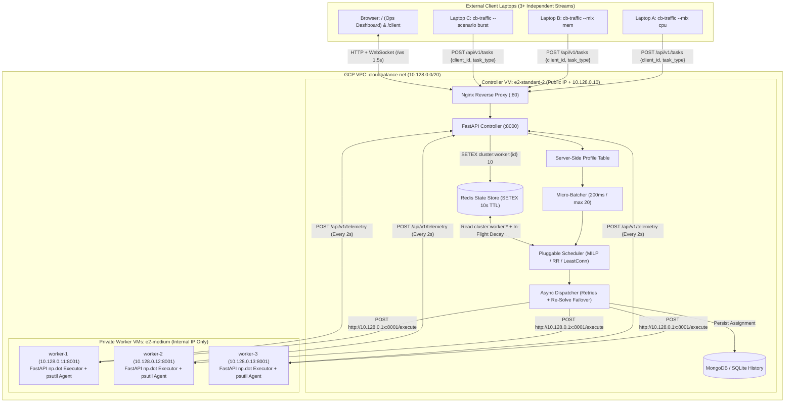

# CloudBalance — Adaptive Multi-Resource Cloud Load Balancer

CloudBalance is a production-grade, closed-loop adaptive cloud load balancer powered by **Mixed-Integer Linear Programming (Google OR-Tools MILP)**. It dynamically schedules heterogeneous compute and memory workloads across internal worker VMs using real-time `psutil` telemetry, decaying in-flight resource reservations, and `200ms` micro-batching.

---

## 1. System Architecture & Network Topology

Only the **Controller VM** exposes a public IP (locked down to `ALLOWED_CIDR`). All **Worker VMs** reside strictly inside the private VPC subnet (`10.128.0.0/20`) with no public IP addresses.



---

## 2. Server-Side Resource Profile Table

Clients **never** declare CPU or RAM requirements—they send only `{"client_id": "...", "task_type": "..."}`. The Controller resolves each task's multi-resource cost from its authoritative server-side profile table (`backend/app/core/profiles.py`):

| `task_type` | CPU Demand (%) | Memory Demand (MB) | Matrix Dimension ($N \times N$) | Target Duration (s) |
|---|---:|---:|---:|---:|
| `CPU_INTENSIVE` | `35%` | `256 MB` | `2400` | `4.0s` |
| `MEMORY_INTENSIVE` | `15%` | `1024 MB` | `4500` | `5.0s` |
| `BALANCED_COMPUTE` | `25%` | `512 MB` | `2000` | `3.0s` |
| `LIGHTWEIGHT_QUERY` | `10%` | `128 MB` | `1000` | `1.5s` |

Worker health statuses (`HEALTHY`, `MODERATE`, `CRITICAL`) are computed strictly as:
- **HEALTHY**: $\text{CPU} < 60\%$ and $\text{RAM} < 70\%$
- **MODERATE**: $\text{CPU} \in [60\%, 84\%]$ or $\text{RAM} \in [70\%, 89\%]$
- **CRITICAL**: $\text{CPU} \ge 85\%$ or $\text{RAM} \ge 90\%$

---

## 3. Quickstart: Zero-Cloud Local Mode

### Option A: Docker Compose (Full 7-Container Stack)
Starts Redis, MongoDB, Controller (`:8000`), 3 Worker containers (`worker-1..3` on `:8001..8003` with distinct virtual capacity profiles), and Nginx + React Frontend (`:5173` / `:80`):

```bash
cp .env.example .env
make dev
# Or directly:
docker compose up --build
```
- **Ops Dashboard**: `http://localhost:5173/`
- **Laptop Client UI**: `http://localhost:5173/client`
- **Controller OpenAPI Docs**: `http://localhost:8000/docs`

### Option B: Native Local Mode (Zero External Daemons Required)
When `CB_LOCAL_MODE=true` (default), the Controller automatically uses an in-memory TTL store (for Redis) and SQLite persistence (for MongoDB) and seeds 3 virtual workers:

```bash
# 1. Start Controller (:8000)
cd backend
python -m uvicorn app.main:app --reload --port 8000

# 2. Start Frontend (:5173)
cd frontend
npm install && npm run dev

# 3. Run Traffic Generator CLI from any terminal
python -m traffic.cli --target-url http://localhost:8000 --client-id laptop-alpha --lambda 6 --mix cpu --scenario steady --max-tasks 40
```

### Quality, Testing & Benchmarking Commands
```bash
make test    # Runs pytest (>=80% coverage gate) + frontend Vitest suite
make lint    # Runs ruff, mypy (strict), and TypeScript tsc --noEmit
make bench   # Replays seeded 3-laptop Poisson trace across all 3 schedulers
```

---

## 4. Quickstart: GCP Compute Engine Deployment

### 1. Provision VPC, Firewalls, Controller & Private Worker VMs
```bash
export GCP_PROJECT_ID="your-gcp-project-id"
export GCP_REGION="us-central1"
export GCP_ZONE="us-central1-a"
# Restrict external ingress strictly to your network/hotspot CIDR (never 0.0.0.0/0)
export ALLOWED_CIDR="$(curl -s https://ifconfig.me)/32"

bash infra/gcp/provision.sh
```

### 2. Retrieve the Public Controller IP
```bash
CONTROLLER_IP=$(gcloud compute instances describe cloudbalance-controller \
  --project="${GCP_PROJECT_ID}" \
  --zone="${GCP_ZONE}" \
  --format='get(networkInterfaces[0].accessConfigs[0].natIP)')
echo "Controller Public URL: http://${CONTROLLER_IP}"
```

### 3. Run `cb-traffic` from 3+ Client Laptops
Install the traffic CLI on each laptop (`pip install -e ./traffic`) and point all laptops at the single public Controller IP:

```bash
# Laptop 1 (Heavy CPU Stream)
cb-traffic --target-url "http://${CONTROLLER_IP}:8000" \
  --client-id laptop-alpha --lambda 6.0 --mix cpu --scenario steady --max-tasks 200 --seed 101

# Laptop 2 (Heavy Memory Stream)
cb-traffic --target-url "http://${CONTROLLER_IP}:8000" \
  --client-id laptop-beta --lambda 5.0 --mix mem --scenario steady --max-tasks 200 --seed 202

# Laptop 3 (Bursty Mixed Stream)
cb-traffic --target-url "http://${CONTROLLER_IP}:8000" \
  --client-id laptop-gamma --lambda 7.0 --mix balanced --scenario burst --max-tasks 250 --seed 303
```

### 4. Inspect Service Logs on GCP
```bash
# View Controller structured JSON logs
gcloud compute ssh cloudbalance-controller --zone="${GCP_ZONE}" \
  --command="sudo journalctl -u cloudbalance-controller -f"

# View internal Worker-1 logs (via IAP / jump host)
gcloud compute ssh cloudbalance-worker-1 --zone="${GCP_ZONE}" --tunnel-through-iap \
  --command="sudo journalctl -u cloudbalance-worker-executor -u cloudbalance-worker-agent -f"
```

### 5. Teardown GCP Infrastructure
```bash
bash infra/gcp/teardown.sh
```

---

## 5. Step-by-Step Live 3-Laptop Demo Script

1. **Step 1 — Idle Baseline**:
   - Open the Ops Dashboard (`http://<CONTROLLER_IP>/`).
   - Verify the header shows `CONNECTED`, active scheduler `OR-Tools MILP`, `Queue: 0`, and all worker cards (`worker-1`, `worker-2`, `worker-3`) in green `HEALTHY` state (`<20%` CPU).
2. **Step 2 — 3 Laptops Start Steady Heterogeneous Streams**:
   - Open `http://<CONTROLLER_IP>/client` on 3 laptops (or run the 3 `cb-traffic` commands above) with `laptop-alpha` (`cpu` mix), `laptop-beta` (`mem` mix), and `laptop-gamma` (`balanced` mix).
   - Observe the **Connected Client Laptops** panel update live with each laptop's arrival rate ($\lambda_i$), while the global header displays the superposed arrival rate $\Lambda_{\text{total}} = \sum \lambda_i$.
   - Observe in the **Rolling 60-Point Chart** that `OR-Tools MILP` routes `laptop-beta`'s `1024 MB` memory tasks away from RAM-constrained nodes and spreads `laptop-alpha`'s `35%` CPU tasks evenly below the `85%` CPU cap line.
3. **Step 3 — One Laptop Injects a Heavy Spike**:
   - On `laptop-gamma`, switch `--scenario burst` (or click **Inject Burst Spike (+12 CPU)** on the Ops Dashboard / **Send one heavy task** repeatedly on `/client`).
   - Watch the micro-batcher absorb the spike and the MILP solver keep worker utilization balanced below the red dashed `85%` cap line (or gracefully enter `DEGRADED_FALLBACK` with an amber alert banner if total demand exceeds physical cluster capacity).
4. **Step 4 — Hot-Swap to Round Robin Live & Observe Degradation**:
   - In the Ops Dashboard **Control Panel**, click **Round Robin** (`POST /api/v1/control/scheduler`).
   - Immediately observe on the CPU & RAM chart that because Round Robin is resource-blind, consecutive `CPU_INTENSIVE` tasks land on already-busy workers, pushing individual worker cards into red `CRITICAL` (`>=85%` CPU) while other workers sit underutilized.
   - Switch back to **OR-Tools MILP** and watch the cluster re-stabilize within 2 micro-batch cycles.
5. **Step 5 — Kill `worker-2` & Demonstrate Automatic Failover**:
   - Click the red power-off button on `worker-2`'s card (or `sudo systemctl stop cloudbalance-worker-agent cloudbalance-worker-executor` on `worker-2`).
   - Any in-flight dispatch to `worker-2` automatically retries, evicts `cluster:worker:worker-2` from Redis, **re-solves the MILP** across `worker-1` and `worker-3`, and completes the task with zero dropped client requests. Within `10s`, `worker-2`'s Redis TTL expires.
   - Click **Restore VMs** to bring `worker-2` back online and watch traffic automatically rebalance across all 3 VMs.
6. **Step 6 — Verify Per-Client Attribution**:
   - Check the **Connected Client Laptops** panel on `/` and the live task table on each laptop's `/client` page to verify exact per-VM task counts (`served_by: {worker-1: X, worker-2: Y, worker-3: Z}`).

---

## 6. Benchmark Report (`benchmark/run_benchmark.py`)

Replaying the **exact same seeded 3-laptop Poisson arrival stream** (`120` tasks across `laptop-alpha-cpu`, `laptop-beta-mem`, and `laptop-gamma-burst`, `seed=42`) against all 3 schedulers yields:

| Scheduler | Mean CPU StdDev (%) | Max CPU StdDev (%) | Peak CPU (%) | Peak RAM (%) | Cap Violations | Mean Latency (ms) | P95 Latency (ms) | Mean Solver (ms) | Throughput (tasks/s) |
|---|---:|---:|---:|---:|---:|---:|---:|---:|---:|
| `ortools_milp` | **5.11%** | 15.85% | **83.3%** | 79.2% | **0** | **385.8** | **514.2** | 10.211 | 14.56 |
| `least_connections` | **10.88%** | 24.29% | 88.9% | 71.6% | **3** | 397.1 | 574.6 | 0.015 | 14.56 |
| `round_robin` | **11.04%** | 24.36% | 88.9% | 71.6% | **3** | 397.5 | 574.6 | 0.009 | 14.56 |

- **2.16x Lower CPU Imbalance**: `ortools_milp` cuts inter-worker CPU standard deviation from `11.04%` (`round_robin`) and `10.88%` (`least_connections`) down to **`5.11%`**.
- **Zero SLA Cap Violations**: `ortools_milp` respects the `85%` CPU and `90%` RAM safety caps (`0` violations, peak CPU `83.3%`), whereas both baselines breach the `85%` CPU threshold (`88.9%` peak).
- **Generated Artifacts**: CSV (`benchmark/results/benchmark_metrics.csv`), Markdown (`benchmark/results/benchmark_report.md`), and PNG charts (`benchmark/results/scheduler_comparison.png`, `benchmark/results/cpu_stddev_timeseries.png`).

---

## 7. Viva & Architecture Cheat-Sheet

### Q1: How does the Poisson traffic generator work mathematically?
Arrivals in a homogeneous Poisson process of rate $\lambda$ (tasks/sec) have independent and identically distributed $\text{Exponential}(\lambda)$ inter-arrival times with CDF $F(t) = 1 - e^{-\lambda t}$. By **inverse-transform sampling**, drawing $U \sim \text{Uniform}[0, 1)$, we compute the exact delay to the next task as:
$$\Delta t = \frac{-\ln(1 - U)}{\lambda}$$

### Q2: Why do 3 independent laptops form a single Poisson process at the Controller?
By the **Superposition Theorem for Poisson Processes**, if $M$ independent clients generate Poisson streams with rates $\lambda_1, \lambda_2, \dots, \lambda_M$ (where $N_m(t) \sim \text{Poisson}(\lambda_m t)$), the sum of independent Poisson random variables is Poisson distributed:
$$N_{\text{total}}(t) = \sum_{m=1}^{M} N_m(t) \sim \text{Poisson}\!\left(t \sum_{m=1}^{M} \lambda_m\right)$$
Thus the merged stream arriving at `POST /api/v1/tasks` is a Poisson process with combined rate $\Lambda_{\text{total}} = \sum_{m=1}^{M} \lambda_m$.

### Q3: What is the exact OR-Tools MILP formulation?
Given a micro-batch of $N$ tasks ($i \in \{1,\dots,N\}$ with demands $c_i, m_i$) and $M$ active workers ($j \in \{1,\dots,M\}$ with current telemetry $\text{cpu}_j, \text{mem}_j$, total memory $T_j$, and decayed in-flight reservations $\hat{c}_j, \hat{m}_j$):

- **Decision Variables**:
  - $X_{i,j} \in \{0, 1\}$: $1$ if task $i$ is assigned to worker $j$, else $0$.
  - $Z \in [0, 100]$: Continuous minimax variable representing peak projected CPU % across all workers.
  - $P_{\text{mem}} \in [0, 100]$: Continuous minimax variable representing peak projected Memory % across all workers.
- **Objective Function** (Minimax CPU with RAM tie-breaker):
  $$\min \; Z + 0.001 \cdot P_{\text{mem}}$$
- **Constraints**:
  1. **Single Assignment**: $\sum_{j=1}^{M} X_{i,j} = 1 \quad \forall i \in \{1,\dots,N\}$
  2. **Hard CPU Safety Cap ($85\%$)**: $\text{cpu}_j + \hat{c}_j + \sum_{i=1}^{N} c_i X_{i,j} \le 85.0 \quad \forall j$
  3. **Hard Memory Safety Cap ($90\%$)**: $\text{mem}_j + \hat{m}_j + \sum_{i=1}^{N} m_i X_{i,j} \le 0.90 \cdot T_j \quad \forall j$
  4. **Minimax Peak CPU Bound**: $\text{cpu}_j + \hat{c}_j + \sum_{i=1}^{N} c_i X_{i,j} \le Z \quad \forall j$
  5. **Minimax Peak RAM % Bound**: $\frac{100}{T_j}\left(\text{mem}_j + \hat{m}_j + \sum_{i=1}^{N} m_i X_{i,j}\right) \le P_{\text{mem}} \quad \forall j$

### Q4: Why does MILP beat heuristics like Round Robin and Least Connections?
- **Round Robin** ignores both task size and worker utilization: assigning a `35%` `CPU_INTENSIVE` task after a `10%` `LIGHTWEIGHT_QUERY` treats them identically.
- **Least Connections** counts only the *number* of active tasks: a worker running 1 `MEMORY_INTENSIVE` (`1024 MB`) task looks "less loaded" than a worker running 2 `LIGHTWEIGHT_QUERY` (`256 MB` total) tasks, causing OOM/RAM cap violations.
- **OR-Tools MILP** jointly optimizes across **multi-dimensional resource capacities** (CPU % and Memory MB simultaneously) over the entire micro-batch.

### Q5: Why use `200ms` micro-batching instead of scheduling 1 task at a time?
1. **Combinatorial Joint Optimization**: Scheduling $k \le 20$ tasks together allows the MILP solver to pack complementary tasks (e.g., pairing a `CPU_INTENSIVE` task with a `MEMORY_INTENSIVE` task across appropriate nodes) rather than making myopic greedy choices.
2. **Amortized Solver Overhead**: Running CBC/SCIP once every `200ms` (taking `~5-10ms`) amortizes solver latency across up to `20` tasks (`<0.5ms` per task).

### Q6: Why use Redis `SETEX 10s` TTL + In-Flight Reservations?
- **Passive Zero-Lock Failover (`SETEX cluster:worker:{id} 10`)**: Workers push `psutil` heartbeats every `2s`. If a worker VM crashes or loses network connectivity, its Redis key automatically expires after `10s` without requiring complex distributed consensus or active health-check polling.
- **In-Flight Reservations with Decay**: Because `psutil` telemetry arrives every `2s` while micro-batches run every `200ms`, up to 10 batches can be scheduled between two heartbeats. Tracking dispatched tasks with linear time decay prevents consecutive batches from piling onto the same "apparently idle" worker during the `2s` telemetry lag window.

