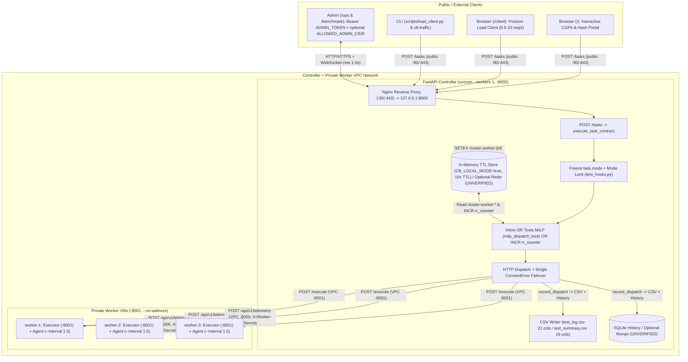

# CloudBalance — Adaptive Multi-Resource Cloud Load Balancer

CloudBalance is a closed-loop adaptive cloud load balancer powered by **Mixed-Integer Linear Programming (Google OR-Tools MILP)**. It dynamically schedules heterogeneous compute and memory workloads across internal worker VMs using real-time `psutil` telemetry, decaying in-flight resource reservations, and isolated OR-Tools MILP vs atomic Round Robin dispatch.

---

## Repository Structure

```text
CLOUD-BALANCE/
│
├── backend/                    # FastAPI Controller (:8000), OR-Tools MILP + RR dispatch, requirements.txt, tests/
├── frontend/                   # React 18 + TypeScript + Tailwind SPA (/, /client, /ops, /benchmark)
├── worker/                     # Worker FastAPI Executor (:8001-8003), psutil Agent, entrypoint.sh, requirements.txt
├── deploy/                     # Production VM deployment templates (controller/worker env, nginx, systemd, gcp/README.md)
├── infra/                      # GCP provisioning/startup/teardown scripts (infra/gcp/*.sh), Docker Nginx & systemd units
├── scripts/                    # Launchers (run_local.{ps1,sh}), load_client.py, preflight.py, smoke_test.py,
│                               # verify_{rr_isolation,milp_inflight,worker_b1}.py, final_acceptance.py
├── traffic/                    # Asynchronous Poisson traffic generator CLI (cb-traffic)
├── benchmark/                  # Offline 2-scheduler benchmark suite (run_benchmark.py) & results/
├── docs/                       # Consolidated documentation: audit/, proof/, project-reports/, drafts/
├── tests/                      # Root test package initialization (active pytest suite in backend/tests/)
├── .env.example                # Local single-machine environment template
├── conftest.py                 # Pytest root configuration
├── docker-compose.yml          # Secondary containerized stack (images not built or tested)
├── Makefile                    # Developer test/lint/bench targets
└── README.md                   # Complete project documentation & setup guide
```

### Dependency Manifests (Role-Split & Exact-Pinned)

| Manifest | Role / Consumer | Contents |
|---|---|---|
| [backend/pyproject.toml](file:///c:/Users/sumed/Desktop/CLOUD%20BALANCE/backend/pyproject.toml) | Controller package + `[dev]`, `[bench]` extras | Canonical controller pins + `pytest`, `ruff`, `mypy`, `matplotlib==3.11.2` |
| [backend/requirements.txt](file:///c:/Users/sumed/Desktop/CLOUD%20BALANCE/backend/requirements.txt) | Controller VM / `backend/Dockerfile` | Exact pinned copy matching `backend/pyproject.toml` dependencies |
| [worker/requirements.txt](file:///c:/Users/sumed/Desktop/CLOUD%20BALANCE/worker/requirements.txt) | Slim Worker VMs / `worker/Dockerfile` | Runtime executor/agent subset (`fastapi`, `uvicorn`, `pydantic`, `numpy`, `psutil`, `httpx`, `structlog`) |
| [traffic/pyproject.toml](file:///c:/Users/sumed/Desktop/CLOUD%20BALANCE/traffic/pyproject.toml) | `cb-traffic` CLI client package | Standalone `httpx` + `pydantic` pins matching controller/worker |
| [frontend/package.json](file:///c:/Users/sumed/Desktop/CLOUD%20BALANCE/frontend/package.json) | Frontend SPA + Vitest + TypeScript | Caret/exact deps locked cleanly via [frontend/package-lock.json](file:///c:/Users/sumed/Desktop/CLOUD%20BALANCE/frontend/package-lock.json) |

### Runtime Prerequisites & Verification Status

| Area | Local Verified Reality | Important Notes |
|---|---|---|
| **Python** | Verified locally on **Python `3.14` (`3.14.7`)** | `requires-python = ">=3.11"`, CI/image targets `3.11` / `3.12`. **Python `3.11 / 3.12` pins are NOT verified locally** and are checked on GCP VMs via `pip check`. |
| **Node.js / npm** | Verified locally on `>= 20` (`v24.11.1` / `npm 11.6.2`) | Frontend dependencies pinned in [frontend/package-lock.json](file:///c:/Users/sumed/Desktop/CLOUD%20BALANCE/frontend/package-lock.json); pre-built bundle at `frontend/dist/`. |
| **Runtime Mode** | **`CB_LOCAL_MODE="true"` + 1 uvicorn process (`--workers 1`)** | Uses in-memory TTL store (`10s` TTL) + SQLite fallback. **Real Redis + MongoDB (`CB_LOCAL_MODE="false"`) is optional and UNVERIFIED end-to-end.** |
| **Docker Compose** | **secondary, images not built or tested** | Compose/Dockerfiles (`docker-compose.yml`, `*/Dockerfile`, `worker/entrypoint.sh`, `infra/nginx/nginx.conf`) are secondary to the native systemd + Nginx GCP path. |
| **GCP Scripts** | Statically checked (`bash -n`, grep, route/CLI checks) | **`infra/gcp/*.sh` have never been executed against real GCP** during local verification. |

---

## Quick Clone & Run Instructions (Local Single-Machine Mode)

1. **Copy and configure `.env`**:
   ```bash
   cp .env.example .env
   ```
   Set strong (>= 32 chars) non-empty values for `ADMIN_TOKEN` and `WORKER_SECRET` in `.env` (the controller refuses to start without them). Keep `CB_LOCAL_MODE="true"` and `WORKER_URLS="http://127.0.0.1:8001,http://127.0.0.1:8002,http://127.0.0.1:8003"`.

2. **Install dependencies and build the frontend**:
   ```bash
   # Full local dev, benchmark & traffic CLI install:
   pip install -e "./backend[dev,bench]" -e ./traffic
   cd frontend && npm ci && npm run build && cd ..
   ```
   Split production requirements files:
   - **Controller VM**: `pip install -r backend/requirements.txt` (`ortools`, `redis`, `motor`, `pydantic-settings`, etc.)
   - **Worker VM**: `pip install -r worker/requirements.txt` (lightweight executor/telemetry runtime — excludes `ortools`, `redis`, and `motor`)

3. **Run local preflight check & start the cluster (Controller + 3 Workers)**:
   ```powershell
   # Validate controller env contract (bare preflight.py requires CB_SEED_DEMO_WORKERS=false,
   # which is already set in GCP deploy/controller.env.example, not in local .env):
   $env:CB_SEED_DEMO_WORKERS="false"; python scripts/preflight.py

   # Windows PowerShell:
   .\scripts\run_local.ps1
   ```
   ```bash
   # Linux / macOS:
   bash scripts/run_local.sh
   ```
   Or directly: `python backend/run_cluster.py`.
   - **Public Workload Portal**: `http://127.0.0.1:8000/` (`public-web-client`: CGPA & SHA-256 tools; zero admin links/tokens)
   - **Public Browser Poisson Client**: `http://127.0.0.1:8000/client` (`ClientLoadPage`: configurable `0.5–10 req/s` Poisson stream + `light`/`heavy` tasks; zero admin links/tokens)
   - **Admin Ops Center**: `http://127.0.0.1:8000/ops` (requires `ADMIN_TOKEN`)
   - **Benchmark Lab**: `http://127.0.0.1:8000/benchmark` (requires `ADMIN_TOKEN`)
   - **Health & Readiness Probes**: `http://127.0.0.1:8000/healthz` and `http://127.0.0.1:8000/ready`

4. **Verify end-to-end against the running cluster**:
   ```bash
   python scripts/smoke_test.py
   python scripts/verify_rr_isolation.py
   python scripts/verify_milp_inflight.py
   python scripts/final_acceptance.py   # Full A-L acceptance checks (script-driven clients)
   ```

5. **Run external CLI benchmark clients (3 concurrent clients)**:
   ```bash
   python scripts/load_client.py --controller http://127.0.0.1:8000 --client-id client-1 --laptop-no 1
   python scripts/load_client.py --controller http://127.0.0.1:8000 --client-id client-2 --laptop-no 2
   python scripts/load_client.py --controller http://127.0.0.1:8000 --client-id client-3 --laptop-no 3
   ```
   *(If `--client-id` is omitted, `load_client.py` defaults to `laptop-<laptop-no>`.)*

---

## Go Public & GCP Deployment

All frontend API requests use relative URLs (`""`) and WebSockets derive `ws://` / `wss://` automatically from `window.location`, requiring zero frontend code edits across tunnels or reverse proxies.

> [!WARNING]
> **Plain-HTTP Token Security:** Plain HTTP (`:80`) sends `Authorization: Bearer <ADMIN_TOKEN>` and `/ws?token=...` unencrypted. Always terminate TLS (e.g., Cloudflare Tunnel / HTTPS) and/or enable the Nginx `ALLOWED_ADMIN_CIDR` allowlist in [deploy/nginx/nginx.conf](file:///c:/Users/sumed/Desktop/CLOUD%20BALANCE/deploy/nginx/nginx.conf) before logging into `/ops` or `/benchmark`.

### Option A: Primary Cloud Deployment (GCP Compute Engine + Nginx + Systemd)

See the complete step-by-step runbook in **[deploy/gcp/README.md](file:///c:/Users/sumed/Desktop/CLOUD%20BALANCE/deploy/gcp/README.md)** (prerequisites, `ADMIN_TOKEN`/`WORKER_SECRET` generation with no defaults, 4 firewall rules isolating `:8000` & `:8001` inside the VPC, reading IPs via `gcloud compute instances list`, pre-share `preflight.py` + `smoke_test.py` from the Controller VM, `/client` public vs `/ops` private setup, worker-down failover behavior, rollback, and mandatory `teardown.sh` cleanup):

1. Set `GCP_PROJECT_ID`, `SUBNET_CIDR`, `ADMIN_SSH_CIDR` (never `0.0.0.0/0`), `ADMIN_TOKEN`, and `WORKER_SECRET` (>= 32 chars each).
2. Provision 1 Controller VM (`<CONTROLLER_STATIC_EXTERNAL_IP>` + `<CONTROLLER_INTERNAL_IP>`) and 3 private `--no-address` Worker VMs behind Cloud Router + NAT:
   ```bash
   bash infra/gcp/provision.sh
   ```
3. Run pre-share smoke test **from the Controller VM** over VPC internal IPs BEFORE sharing `http://<CONTROLLER_STATIC_EXTERNAL_IP>/client`:
   ```bash
   /opt/cloudbalance/venv/bin/python /opt/cloudbalance/scripts/preflight.py --env-file /etc/cloudbalance/controller.env
   /opt/cloudbalance/venv/bin/python /opt/cloudbalance/scripts/smoke_test.py --controller "http://<CONTROLLER_INTERNAL_IP>:8000"
   ```
4. Tear down immediately after review so billing stops:
   ```bash
   bash infra/gcp/teardown.sh
   ```

### Option B: Quick Local Tunnel Demo (Cloudflare Tunnel)

1. Start the local cluster (`.\scripts\run_local.ps1` or `bash scripts/run_local.sh`).
2. Expose controller `:8000`: `cloudflared tunnel --url http://127.0.0.1:8000`.
3. Update `CB_ALLOWED_ORIGINS` if needed, share `https://<subdomain>.trycloudflare.com/client` with clients, and keep `/ops` gated behind Cloudflare Access or strong `ADMIN_TOKEN` (>= 32 chars).

### Option C: Docker Compose *(secondary, images not built or tested)*

`docker-compose.yml` defines Redis, MongoDB, Controller (`--workers 1`), 3 workers (`worker/entrypoint.sh`), and Nginx (`infra/nginx/nginx.conf`, built via `frontend/Dockerfile`). It requires `ADMIN_TOKEN` and `WORKER_SECRET` (`>= 32` chars; blank/short values fail startup) and optional `CB_REQUIRE_API_KEY`. **Container images have not been built or runtime-tested.**

---

## Environment Configuration Reference

Every runtime variable read by `Settings` ([backend/app/core/config.py](file:///c:/Users/sumed/Desktop/CLOUD%20BALANCE/backend/app/core/config.py)) is listed below (matching `.env.example` and [deploy/controller.env.example](file:///c:/Users/sumed/Desktop/CLOUD%20BALANCE/deploy/controller.env.example)):

| Variable | Accepted Alias(es) | Default | Purpose |
|---|---|---|---|
| `CB_APP_NAME` | `APP_NAME` | `CloudBalance Controller` | FastAPI application title |
| `CB_ENV` | `ENVIRONMENT` | `development` | Environment label |
| `ADMIN_TOKEN` | `CB_ADMIN_TOKEN` | *(required, >= 32 chars in deploy)* | Admin Bearer token for `/admin/*`, `/api/v1/control/*`, `/api/v1/telemetry/*`, `/ws` |
| `WORKER_SECRET` | `CB_WORKER_SECRET` | *(required, >= 32 chars in deploy)* | Shared secret for worker heartbeats (`X-Worker-Secret`) |
| `WORKER_URLS` | `CB_WORKER_URLS` | `http://127.0.0.1:8001,http://127.0.0.1:8002,http://127.0.0.1:8003` | Comma-separated worker base URLs (private VPC internal IPs on GCP) |
| `CONTROLLER_URL` | `CB_CONTROLLER_URL`, `CB_BASE_URL` | `http://127.0.0.1:8000` | Controller URL for workers (`http://<CONTROLLER_INTERNAL_IP>:8000` on GCP) & CLI tools |
| `CONTROLLER_HOST` | `CB_CONTROLLER_HOST` | `0.0.0.0` | Uvicorn bind host for controller |
| `CONTROLLER_PORT` | `CB_CONTROLLER_PORT` | `8000` | Uvicorn bind port for controller |
| `CB_FRONTEND_DIST_DIR` | `FRONTEND_DIST_DIR` | `frontend/dist` | Path to built React SPA assets |
| `CB_API_KEY` | `API_KEY` | *(none; required if `CB_REQUIRE_API_KEY=true`)* | Optional `X-API-Key` value for `/api/v1/tasks` callers |
| `CB_REQUIRE_API_KEY` | `REQUIRE_API_KEY` | `false` | Require `X-API-Key` on `/api/v1/tasks` |
| `CB_ALLOWED_ORIGINS` | `ALLOWED_ORIGINS` | `[*]` | Comma-separated CORS origins (set to external origin on GCP) |
| `CB_REDIS_URL` | `REDIS_URL` | `redis://localhost:6379/0` | Optional Redis connection URL (requires `CB_LOCAL_MODE=false`, UNVERIFIED) |
| `CB_MONGO_URL` | `MONGO_URL` | `mongodb://localhost:27017` | Optional MongoDB connection URL (requires `CB_LOCAL_MODE=false`, UNVERIFIED) |
| `CB_MONGO_DB_NAME` | `MONGO_DB_NAME` | `cloudbalance` | MongoDB database name |
| `CB_LOCAL_MODE` | `LOCAL_MODE` | `true` | Force tested in-memory TTL store + SQLite fallback (keep `true` on single-worker GCP) |
| `CB_WORKER_TTL_SECONDS` | `WORKER_TTL_SECONDS` | `10` | Worker telemetry TTL window (s) |
| `CB_MAX_QUEUE_DEPTH` | `MAX_QUEUE_DEPTH` | `500` | Maximum queued depth cap |
| `CB_RATE_LIMIT_PER_SEC` | `RATE_LIMIT_PER_SEC` | `300` | Per-second rate-limit threshold |
| `CB_RATE_LIMIT_PER_MIN` | `RATE_LIMIT_PER_MIN` | `2400` | Sliding-window rate limit per `client_id` |
| `CB_MAX_PAYLOAD_BYTES` | `MAX_PAYLOAD_BYTES` | `65536` | Max request payload size in bytes (matches Nginx `client_max_body_size 64k`) |
| `CB_DATA_DIR` | `DATA_DIR` | `data` | Directory for `test_log.csv` & `test_summary.csv` (`/var/lib/cloudbalance/data` on GCP) |
| `CB_SOLVER_TIME_LIMIT_MS` | `SOLVER_TIME_LIMIT_MS` | `50` | OR-Tools MILP solver time limit (ms) |
| `CB_CPU_CAP_PCT` | `CPU_CAP_PCT` | `85.0` | MILP hard CPU utilization cap (%) |
| `CB_MEM_CAP_PCT` | `MEM_CAP_PCT` | `90.0` | MILP hard memory utilization cap (%) |
| `CB_DISPATCH_TIMEOUT_SEC` | `DISPATCH_TIMEOUT_SEC` | `15.0` | HTTP timeout for controller-to-worker dispatch (s) |
| `CB_DISPATCH_MAX_RETRIES` | `DISPATCH_MAX_RETRIES` | `2` | Worker dispatch retry count |
| `CB_WS_BROADCAST_INTERVAL_SEC` | `WS_BROADCAST_INTERVAL_SEC` | `1.5` | `/ws` snapshot broadcast cadence (s) |
| `CB_DEFAULT_SCHEDULER` | `DEFAULT_SCHEDULER` | `ortools_milp` | Default active scheduler mode (`ortools_milp` or `round_robin`) |
| `CB_SEED_DEMO_WORKERS` | `SEED_DEMO_WORKERS` | `true` | Seed virtual demo workers locally (`MUST be false` on GCP/Docker production) |

**Worker Node Template ([deploy/worker.env.example](file:///c:/Users/sumed/Desktop/CLOUD%20BALANCE/deploy/worker.env.example))**:
- `WORKER_SECRET` (required, matches Controller), `WORKER_ID`, `WORKER_IP`, `WORKER_PORT` (`8001`), `CONTROLLER_URL` (`http://<CONTROLLER_INTERNAL_IP>:8000`)
- `WORKER_ENABLE_AGENT` (`false` when systemd runs dedicated `cloudbalance-worker-agent.service`), `WORKER_TELEMETRY_INTERVAL` (`1.5`), `WORKER_CONCURRENCY_LIMIT` (`2`), `WORKER_QUEUE_CAPACITY` (`4`), `WORKER_TASK_TIMEOUT_SEC` (`10.0`), `MAX_PAYLOAD_BYTES` (`65536`), `HEAVY_TASK_ITERATIONS` (`180000`), `WORKER_TOTAL_MEM_MB` (`4096.0`), `WORKER_BASE_CPU_PCT` (`8.0`), `WORKER_BASE_MEM_MB` (`420.0`), `WORKER_TIME_SCALE` (`0.15`), `WORKER_MAX_PHYSICAL_DIM` (`350`).

---

## Naming, API & CSV Schema Reference

### 1. Scheduler Mode Identifiers (`milp` vs `ortools_milp`)
- **Test lifecycle & request freeze `mode`** (`POST /admin/test/start`, `GET /test/status`, `sched_mode`, `test_log.csv` `mode`, `test_summary.csv` `mode`): canonical values are `"milp"` (`POST /admin/test/start` also accepts `"ortools_milp"`) and `"round_robin"` (`"rr"` alias).
- **Scheduler execution identifiers** (`scheduler_used` in `POST /tasks` and `test_log.csv`, `active_scheduler` in `POST /api/v1/control/scheduler` and `ClusterSnapshot`, and `ORToolsMILPScheduler.name`): `"ortools_milp"` and `"round_robin"`.
- **UI display labels**: `"OR-Tools MILP"` (`ortools_milp`) and `"Round Robin"` (`round_robin`).

### 2. Traffic Source & Client Identifier Conventions (`client-*`, `public-web-client`, `laptop-*`, `sim-*`)
- **Default test `load_source`**: Both `StartTestRequest` (`backend/app/api/admin.py`) and the `/ops` **Start** button (`OpsCenterPage.tsx`) default to `load_source="external"`, expecting real browser clients (`/client`) or CLI generators (`scripts/load_client.py`). The built-in `InternalLoadSimulator` (`sim-1..3`) only runs when `load_source="simulator"` is explicitly passed to `POST /admin/test/start`.
- **Browser Poisson Client (`/client`)**: assigns `client-<4hex>` in `localStorage` or reads `?id=<client_id>` (e.g., `client-1`, `client-2`, `client-3`).
- **Interactive Portal (`/`)**: sends `"public-web-client"` (leaves `client_rate` and `client_task_type` blank in `test_log.csv`).
- **External CLI (`scripts/load_client.py`)**: defaults to `"laptop-<laptop-no>"` unless `--client-id` is passed.
- **Stream CLI (`cb-traffic`)**: defaults to `"laptop-alpha"` unless `--client-id` is passed.
- **Built-in Simulator (`backend/app/core/simulator.py`)**: generates `"sim-1"`, `"sim-2"`, `"sim-3"` (excluded from external `test_log.csv` contract recording).

### 3. API vs CSV Field Name Mapping
- **Execution latency**: worker `/execute` JSON returns `execution_ms` -> controller contract response returns `exec_ms` -> `data/test_log.csv` logs `exec_ms` (distinct from static server profile estimate `duration_sec`).
- **Request rate fields**: test-level rate across the run is `lambda_per_client` (`POST /admin/test/start`, `GET /test/status`, `test_summary.csv`, `test_log.csv`), whereas per-client declared rate from `/client` or external harnesses is `client_rate` (`0.5–10.0` req/s on `POST /tasks` and `test_log.csv`, paired with `client_task_type`).
- **`test_log.csv` (`22` columns)**: `test_id`, `mode`, `seed`, `duration_s`, `lambda_per_client`, `heavy_ratio`, `client_id`, `task_id`, `task_type`, `sent_at`, `scheduler_used`, `dispatch_seq`, `assigned_worker`, `worker_inflight_at_dispatch`, `worker_cpu_pct_at_dispatch`, `queue_ms`, `exec_ms`, `total_ms`, `status`, `failover`, `client_rate`, `client_task_type`.
- **`test_summary.csv` (`19` columns)**: `test_id`, `mode`, `seed`, `duration_s`, `lambda_per_client`, `heavy_ratio`, `requests`, `failed`, `avg_ms`, `p50_ms`, `p95_ms`, `max_ms`, `max_queue_ms`, `throughput_rps`, `worker1_busy_ms`, `worker2_busy_ms`, `worker3_busy_ms`, `busy_time_stddev`, `clients_seen`.

---

## 1. System Architecture & Network Topology

On GCP, only the **Controller VM** exposes ports `:80`/`:443` via Nginx (`<CONTROLLER_STATIC_EXTERNAL_IP>`, with SSH locked to `<ADMIN_SSH_CIDR>` and port `8000` never opened externally). All **3 Worker VMs** reside inside the private VPC subnet with `--no-address`.



---

## 2. Server-Side Resource Profile Table

Clients **never** declare CPU or RAM requirements—they send only `{client_id, task_type, ...}`. The Controller resolves each task's multi-resource cost from its authoritative server-side profile table (`backend/app/core/profiles.py`):

| `task_type` | CPU Demand (%) | Memory Demand (MB) | Matrix Dimension ($N \times N$) | Target Duration (s) | Workload |
|---|---:|---:|---:|---:|---|
| `LIGHT` | `10%` | `64 MB` | `200` | `0.2s` | Lightweight CGPA calculation |
| `HEAVY` | `35%` | `128 MB` | `800` | `1.0s` | Iterative SHA-256 hashing |
| `CPU_INTENSIVE` | `35%` | `256 MB` | `1500` | `3.0s` | Dense compute profile |
| `MEMORY_INTENSIVE` | `15%` | `384 MB` | `2200` | `3.0s` | Memory-intensive profile |
| `BALANCED_COMPUTE` | `25%` | `256 MB` | `1000` | `3.0s` | Balanced CPU/RAM profile |
| `LIGHTWEIGHT_QUERY` | `10%` | `96 MB` | `500` | `1.5s` | Fast low-footprint query |

Worker health statuses (`HEALTHY`, `MODERATE`, `CRITICAL`) are computed strictly as:
- **HEALTHY**: $\text{CPU} < 60\%$ and $\text{RAM} < 70\%$
- **MODERATE**: $\text{CPU} \in [60\%, 84\%]$ or $\text{RAM} \in [70\%, 89\%]$
- **CRITICAL**: $\text{CPU} \ge 85\%$ or $\text{RAM} \ge 90\%$

---

## 3. Quality, Testing & Verification Commands

```bash
python -m pytest -c pytest.ini           # Backend test suite (86 tests)
cd frontend && npm run lint && npm test  # TypeScript check + Vitest suite (13 tests)
python -m ruff check backend tests worker traffic benchmark scripts
CB_SEED_DEMO_WORKERS=false python scripts/preflight.py  # Requires CB_SEED_DEMO_WORKERS=false (set in GCP controller.env, not local .env)
python scripts/smoke_test.py             # Live auth, /ws, /healthz, /ready & POST /tasks smoke test
python scripts/verify_rr_isolation.py    # 30 concurrent tasks, strict w1->w2->w3, solver_call_count == 0
python scripts/verify_milp_inflight.py   # 20 concurrent MILP tasks distributed across 3/3 workers
python scripts/final_acceptance.py       # Full A-L live acceptance verification (B1 integrity PASS, B2 observation)
python benchmark/run_benchmark.py        # Seeded offline 2-scheduler benchmark + charts
```

> [!NOTE]
> Under `round_robin` bursts, bounded worker queues (`WORKER_QUEUE_CAPACITY=4`) can reject overflow tasks with `status="rejected_503"` (expected behavior; counted in `test_summary.csv` `failed` and reported as observation `B2` in `final_acceptance.py`, whereas `ortools_milp` avoids queue saturation using real-time telemetry and in-flight reservations).

---

## 4. Step-by-Step Controlled Test & Live Demo Flow

1. **Step 1 — Verify Cluster Baseline (`/ops`)**:
   - Open `http://<CONTROLLER_URL>/ops` and sign in with `ADMIN_TOKEN`.
   - Confirm the WebSocket badge shows `CONNECTED`, active scheduler shows `OR-Tools MILP`, and `worker-1`, `worker-2`, `worker-3` report live `psutil` telemetry.
2. **Step 2 — Arm & Start a Controlled Test Run (`/ops` or `POST /admin/test/start`)**:
   - Select scheduler (`ortools_milp` / `mode="milp"` or `round_robin`), `Duration (s)`, `Rate λ`, `Heavy ratio`, and `Seed`, then click **Start**.
   - `/ops` sends `load_source: "external"` by default, transitioning through `idle -> armed (5s) -> running (duration_s) -> draining (up to 15s) -> idle`. Mode switches via `POST /api/v1/control/scheduler` return `HTTP 409` while locked.
3. **Step 3 — Drive Heterogeneous Load from Browser Tabs (`/client`) or CLI (`scripts/load_client.py`)**:
   - Open `http://<CONTROLLER_URL>/client?id=client-1` (and `client-2`, `client-3`) on client devices/tabs, choose per-client rate (`0.5–10 req/s`) and task type (`light` CGPA or `heavy` SHA-256), and click **Start Poisson** — or launch external CLI clients with `python scripts/load_client.py --client-id client-1 ...`.
   - Each request calls `POST /tasks`, freezes `task.mode` on arrival, routes through `execute_task_contract -> record_dispatch`, and appends a row to `data/test_log.csv` (`22` columns) with `client_rate` and `client_task_type`.
4. **Step 4 — Compare Paired `milp` vs `round_robin` Runs**:
   - Run a paired test in `round_robin` (`rr_counter` atomic `INCR`, `solver_call_count == 0`) with identical client rates and task types.
   - Upon drain completion, the controller writes one summary row per run to `data/test_summary.csv` (`19` columns) including `avg_ms`, `p50_ms`, `p95_ms`, `max_ms`, `max_queue_ms`, `throughput_rps`, `worker1_busy_ms`..`worker3_busy_ms`, `busy_time_stddev`, and `clients_seen`.
   - Inspect **Benchmark Results & Comparison** on `/ops` or `/benchmark`, and download `test_summary.csv` and `test_log.csv` (admin-only).

---

## 5. Offline Benchmark Snapshot (`benchmark/results/`)

Saved offline benchmark artifacts in `benchmark/results/` (`benchmark_metrics.csv`, `benchmark_report.md`, `scheduler_comparison.png`, `cpu_stddev_timeseries.png`) record a seeded Poisson trace (`120` tasks, `seed=42`) comparing `ortools_milp` against `round_robin`:

| Scheduler | Mean CPU StdDev (%) | Max CPU StdDev (%) | Peak CPU (%) | Peak RAM (%) | Cap Violations | Mean Latency (ms) | P95 Latency (ms) | Mean Solver (ms) | Throughput (tasks/s) |
|---|---:|---:|---:|---:|---:|---:|---:|---:|---:|
| `ortools_milp` | **5.65%** | 16.69% | **83.3%** | 33.8% | **0** | 303.0 | **352.7** | 18.535 | 14.56 |
| `round_robin` | **11.04%** | 24.36% | 88.9% | 30.5% | **3** | 299.2 | 458.5 | 0.021 | 14.56 |

---

## 6. Architecture Notes & FAQ

### Q1: How does the Poisson traffic generator work mathematically?
Arrivals in a homogeneous Poisson process of rate $\lambda$ (req/s) have i.i.d. $\text{Exponential}(\lambda)$ inter-arrival gaps. Both `/client` (`sampleExponentialGapMs`) and CLI harnesses use inverse-transform sampling:
$$\Delta t = \frac{-\ln(1 - U)}{\lambda}, \quad U \sim \text{Uniform}[0, 1)$$

### Q2: Why do 3 independent clients form a single Poisson process at the Controller?
By the **Superposition Theorem for Poisson Processes**, merging $M$ independent Poisson arrival streams with rates $\lambda_1, \dots, \lambda_M$ at `POST /tasks` produces a combined Poisson stream with aggregate rate $\Lambda_{\text{total}} = \sum_{m=1}^{M} \lambda_m$.

### Q3: What is the OR-Tools MILP formulation (`ortools_milp.py`)?
For candidate workers $j \in \{1,\dots,M\}$ with current telemetry $(\text{cpu}_j, \text{mem}_j, T_j)$, decayed in-flight reservations $(\hat{c}_j, \hat{m}_j)$, and task demands $(c_i, m_i)$:
- **Decision Variables**: $X_{i,j} \in \{0, 1\}$ (assignment), Peak CPU bound $Z \in [0, 100]$, Peak Memory % bound $P_{\text{mem}} \in [0, 100]$.
- **Constraints**: Single assignment ($\sum_j X_{i,j} = 1$), hard CPU cap ($85\%$), hard RAM cap ($90\%$), minimax CPU & RAM % bounds.

### Q4: How do `ortools_milp` and `round_robin` stay strictly isolated on `POST /tasks`?
- Every arriving request reads active test/cluster mode once and freezes it onto `task.mode`.
- `task.mode == "round_robin"` increments atomic `rr_counter` and cycles deterministically across `WORKER_URLS` without acquiring `milp_dispatch_lock` or calling OR-Tools (`solver_call_count` remains `0`).
- `task.mode == "milp"` acquires `milp_dispatch_lock` to serialize reading telemetry + calling `ORToolsMILPScheduler` (`scheduler_used="ortools_milp"`) + incrementing per-worker `in_flight` reservation before HTTP dispatch.

### Q5: Why does state use a `10s` TTL + In-Flight Tracking?
- **Passive TTL Expiration (`SETEX cluster:worker:{id} 10`)**: Worker agents push `psutil` heartbeats every `1.5s`. If a worker goes offline, its key expires within `10s`, and HTTP `ConnectError` / `NetworkError` failover evicts it immediately and retries once on another healthy worker (heartbeat resumption re-admits it automatically).
- **Per-Worker In-Flight Tracking (`try/finally` decrement)**: Concurrent requests arriving between `1.5s` telemetry heartbeats see immediate in-flight reservations so `ortools_milp` avoids piling onto the same worker.
