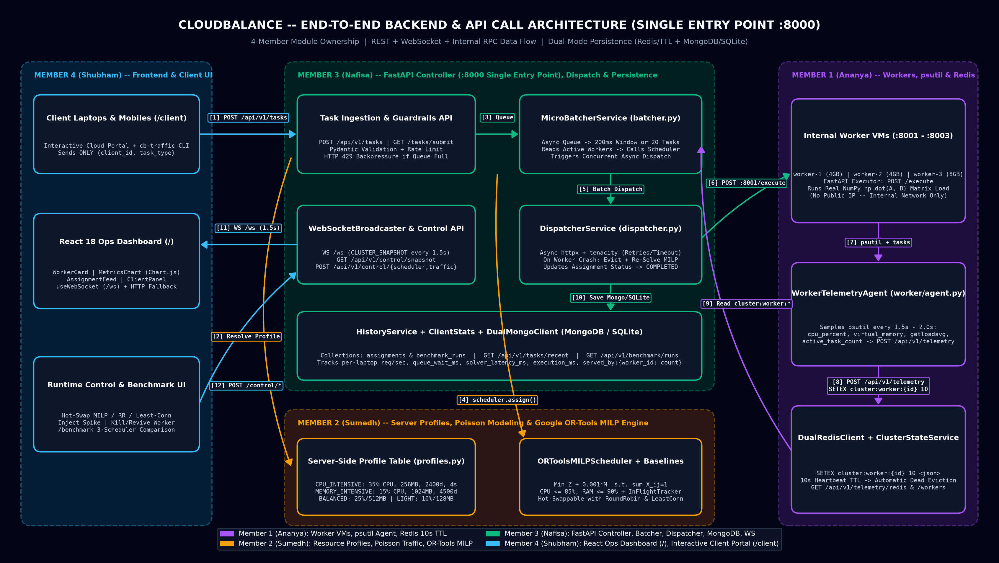

# CloudBalance — Project Introduction, Member-Wise Workload Distribution & Backend API Architecture



---

## 1. Project Introduction

**CloudBalance** is an adaptive, multi-resource cloud load balancer designed to overcome the core limitation of traditional cloud load-balancing heuristics (such as Round Robin and Least Connections). Traditional load balancers route incoming requests blindly without considering:
1. **Multi-dimensional task resource costs** (a CPU-heavy AI inference job vs. a RAM-heavy in-memory graph query vs. a lightweight database lookup).
2. **Live heterogeneous server utilization** (real-time CPU percentage, physical RAM usage, and in-flight queued load across worker VMs of different capacities).

CloudBalance solves this through a **four-stage closed-loop feedback architecture (`Monitor -> Optimize -> Dispatch -> Visualize`)** exposed behind a **Single Public Entry Point (`:8000`)**:
- **Clients (3+ Laptops & Mobile Devices)** only know the Controller's single URL (`http://<Controller-IP>:8000`). Clients never declare raw CPU or RAM numbers; they interact with the Client Portal (`/client`) or run the `cb-traffic` CLI and send only `{ "client_id": "...", "task_type": "..." }`.
- **The FastAPI Controller (`:8000`)** validates requests, applies rate-limiting and queue backpressure (`HTTP 429`), maps each `task_type` to its authoritative server-side resource profile (`cpu_demand_pct`, `mem_demand_mb`, `duration_sec`, `matrix_dim`), collects tasks into **200ms micro-batches**, reads live worker telemetry from **Redis (`cluster:worker:*`)**, and asks the **Google OR-Tools Mixed-Integer Linear Programming (MILP) Scheduler** for the globally optimal task-to-worker assignment matrix $X_{ij}$.
- **Private Internal Worker VMs (`:8001`, `:8002`, `:8003`)** have no public IP exposure. They receive dispatched tasks over the internal network (`POST /execute`), execute genuine **NumPy (`np.dot`)** matrix multiplications, and run a **`psutil` Telemetry Agent** that reports real-time CPU, RAM, load average, and active task counts back to the Controller every 1.5–2.0 seconds (`SETEX cluster:worker:{id} 10`).
- **Dual-Database Persistence & Live WebSocket Streaming**: Ephemeral live state is stored in **Redis** (with 10s worker TTL for automatic dead-node eviction), historical assignments and benchmark runs are stored in **MongoDB / SQLite**, and a **1.5s WebSocket Broadcaster (`/ws`)** pushes live `CLUSTER_SNAPSHOT` frames to the React 18 Ops Dashboard (`/`) and Client Portal (`/client`).

---

## 2. Master 4-Member Workload Distribution Matrix (Current Production Build)

| Member | Name & Role | Core Technologies | Exact Files Owned in Current Project Build |
| :--- | :--- | :--- | :--- |
| **Member 1** | **Ananya**<br>*Monitoring, Telemetry Agent & Redis State* | Python, `psutil`, Redis (`SETEX` 10s TTL), GCP Ubuntu Worker VMs | • `worker/agent.py` (`WorkerTelemetryAgent`, `sample_worker_telemetry`)<br>• `backend/app/core/redis_client.py` (`DualRedisClient`, `InMemoryTTLStore`)<br>• `backend/app/services/cluster_state.py` (`ClusterStateService`)<br>• `backend/app/api/telemetry.py` (`POST /api/v1/telemetry`, `GET /workers`, `GET /redis`)<br>• `infra/gcp/provision.sh`, `startup-worker.sh`, `infra/systemd/*` |
| **Member 2** | **Sumedh**<br>*Workload Modeling, Poisson Traffic & OR-Tools MILP Optimizer* | Python, NumPy (`np.dot`), Poisson Process, Google OR-Tools (`pywraplp` CBC/SCIP) | • `backend/app/core/profiles.py` (`TASK_PROFILES`, `resolve_task_profile`)<br>• `worker/executor.py` (`_run_numpy_dot_kernel`, `POST /execute`)<br>• `traffic/poisson_generator.py`, `traffic/workloads.py`, `traffic/cli.py`<br>• `backend/app/schedulers/base.py` (`BaseScheduler`, `InFlightTracker`)<br>• `backend/app/schedulers/ortools_milp.py` (`ORToolsMILPScheduler`)<br>• `backend/app/schedulers/round_robin.py`, `least_connections.py`<br>• `benchmark/run_benchmark.py` |
| **Member 3** | **Nafisa**<br>*FastAPI Backend, Micro-Batcher, Dispatcher, WebSockets & MongoDB* | FastAPI, Pydantic v2, `httpx`, `tenacity`, WebSockets, MongoDB (`motor` + SQLite) | • `backend/app/main.py` (App factory, lifespan, CORS, SPA static mount)<br>• `backend/app/models/schemas.py` (All Pydantic v2 contracts)<br>• `backend/app/api/tasks.py`, `control.py`, `websocket.py`, `health.py`, `benchmark.py`<br>• `backend/app/services/batcher.py` (`MicroBatcherService`)<br>• `backend/app/services/dispatcher.py` (`DispatcherService` + failover)<br>• `backend/app/services/broadcaster.py` (`WebSocketBroadcaster`)<br>• `backend/app/services/history.py`, `client_stats.py`<br>• `backend/app/core/mongo_client.py`, `config.py`, `security.py`, `logging.py`<br>• `backend/run_cluster.py` |
| **Member 4** | **Shubham**<br>*React Ops Dashboard, Interactive Client Portal & Chart.js Visualization* | React 18, TypeScript, Vite, Tailwind CSS, Chart.js, WebSockets | • `frontend/src/pages/DashboardPage.tsx` (Main Ops Dashboard `/`)<br>• `frontend/src/pages/ClientPage.tsx` (Interactive Client Portal `/client`)<br>• `frontend/src/pages/BenchmarkPage.tsx` (3-Scheduler Comparison UI)<br>• `frontend/src/components/Header.tsx`, `WorkerCard.tsx`, `MetricsChart.tsx`, `AssignmentFeed.tsx`, `ClientPanel.tsx`, `ControlPanel.tsx`<br>• `frontend/src/hooks/useWebSocket.ts`<br>• `frontend/src/lib/api.ts`, `frontend/src/lib/types.ts` |

---

## 3. How the API Calls Work Across the Whole System (Step-by-Step Lifecycle)

Every numbered step below corresponds directly to `[1]`–`[12]` in the architecture diagram above:

### Step `[1]` — Client Sends Task Request to Single Public Entry Point (`:8000`)
- **Caller**: Laptop/Mobile Browser on `/client` (`frontend/src/lib/api.ts`) or `cb-traffic` CLI (`traffic/cli.py`).
- **Endpoint**: `POST /api/v1/tasks` (with automatic idempotent fallback `GET /api/v1/tasks/submit?client_id=...&task_type=...` for mobile hotspots).
- **Request Payload**:
  ```json
  {
    "client_id": "laptop-alpha",
    "task_type": "CPU_INTENSIVE"
  }
  ```
- **Guardrails Checked (`backend/app/api/tasks.py`)**:
  1. `verify_api_key` checks `X-API-Key` when `CB_REQUIRE_API_KEY=true`.
  2. `TokenBucketRateLimiter` checks per-second burst limits (`HTTP 429` if exceeded).
  3. Queue depth check: if `batcher.queue_depth >= max_queue_depth`, immediately returns `HTTP 429 Too Many Requests` (backpressure).

### Step `[2]` — Server-Side Resource Profile Resolution
- **Module**: `backend/app/core/profiles.py` (`resolve_task_profile`) & `Task.from_request()` (`backend/app/models/schemas.py`).
- **What Happens**: Clients never specify CPU% or RAM MB. The Controller looks up `task_type` in its authoritative table:
  - `CPU_INTENSIVE` $\rightarrow$ `35.0% CPU`, `256.0 MB RAM`, `2400×2400 matrix`, `4.0s duration`
  - `MEMORY_INTENSIVE` $\rightarrow$ `15.0% CPU`, `1024.0 MB RAM`, `4500×4500 matrix`, `5.0s duration`
  - `BALANCED_COMPUTE` $\rightarrow$ `25.0% CPU`, `512.0 MB RAM`, `2000×2000 matrix`, `3.0s duration`
  - `LIGHTWEIGHT_QUERY` $\rightarrow$ `10.0% CPU`, `128.0 MB RAM`, `1000×1000 matrix`, `1.5s duration`

### Step `[3]` — Enqueue into Micro-Batcher (`200ms` Window or `20` Tasks)
- **Module**: `backend/app/services/batcher.py` (`MicroBatcherService.enqueue`).
- **What Happens**:
  - The enriched `Task` is appended to an async queue (`collections.deque`), and `client_stats.record_enqueue()` updates per-client arrival rates (`req/s`).
  - The task is also cached in Redis (`SETEX cluster:task:{task_id} 60 <json>`).
  - The Controller immediately returns `HTTP 202 Accepted` to the client with the generated `task_id` and `queue_depth`.

### Step `[4]` & `[9]` — Micro-Batcher Reads Live Workers from Redis & Calls Scheduler
- **Modules**: `ClusterStateService.get_active_workers()` (`backend/app/services/cluster_state.py`) $\rightarrow$ `ORToolsMILPScheduler.assign()` (`backend/app/schedulers/ortools_milp.py`).
- **What Happens**:
  - Every `200ms` (or immediately when 20 tasks accumulate), `flush_one_batch()` reads all non-expired `cluster:worker:*` keys from Redis (`[9]`).
  - It passes `(batch_tasks, active_workers)` to the active scheduler (`ortools_milp`, `round_robin`, or `least_connections`).
  - **OR-Tools MILP** combines each worker's Redis telemetry with `InFlightTracker` reservations, solves the binary assignment problem ($\min Z + 0.001 M$ subject to $\sum_j X_{ij}=1$, $\text{CPU}_j \le 85\%$, $\text{RAM}_j \le 90\%$), registers new in-flight reservations, and returns `BatchAssignmentResult(assignments, meta)`.

### Step `[5]` & `[6]` — Internal HTTP Dispatch to Worker Executor (`:8001–8003`) & Automatic Failover
- **Module**: `backend/app/services/dispatcher.py` (`DispatcherService.dispatch_task`).
- **Endpoint Called (Internal RPC)**: `POST http://<worker_internal_ip>:<port>/execute` (e.g., `http://127.0.0.1:8001/execute` locally or `http://10.128.0.11:8001/execute` on GCP VPC).
- **Request Payload**:
  ```json
  {
    "task_id": "tsk-a53ed9071d",
    "duration_sec": 4.0,
    "matrix_dim": 2400,
    "cpu_demand_pct": 35.0,
    "mem_demand_mb": 256.0
  }
  ```
- **Retries & Automatic Re-Solve Failover**:
  - Uses `tenacity.AsyncRetrying` (`stop_after_attempt`, timeout).
  - If a worker VM crashes or times out, `DispatcherService` immediately releases its in-flight reservation, evicts `cluster:worker:{failed_id}` from Redis, **re-runs the scheduler excluding the failed worker**, and dispatches the task to the newly chosen healthy worker VM.

### Step `[7]` & `[8]` — Worker Executes Real `np.dot` & Reports `psutil` Telemetry to Redis
- **Modules**: `worker/executor.py` (`execute_workload`) & `worker/agent.py` (`WorkerTelemetryAgent`) $\rightarrow$ `POST /api/v1/telemetry` (`backend/app/api/telemetry.py`).
- **What Happens**:
  - The Worker increments its active task counters, immediately pushes a live telemetry update to `POST /api/v1/telemetry`, and runs real NumPy matrix multiplications (`np.dot(a, b)`) in a worker thread.
  - Every `1.5s–2.0s` (and upon task start/completion), the worker agent samples `psutil.cpu_percent()`, `psutil.virtual_memory()`, `os.getloadavg()`, and `active_task_count` and sends `POST /api/v1/telemetry`.
  - The Controller executes `SETEX cluster:worker:{worker_id} 10 <json>` in Redis (`[8]`). If a worker dies and stops sending heartbeats, its Redis key automatically expires after 10 seconds.

### Step `[10]` — Persist Assignment & Completion Status to MongoDB / SQLite
- **Modules**: `backend/app/services/history.py` (`HistoryService`) & `backend/app/core/mongo_client.py` (`DualMongoClient`).
- **What Happens**:
  - When a task is scheduled, an `Assignment` record (`status="ASSIGNED"`) is saved.
  - When `POST /execute` returns `200 OK` with `execution_ms`, `HistoryService` updates the record to `status="COMPLETED"` with the real execution time in both MongoDB/SQLite (`assignments` collection/table) and Redis (`cluster:assignment:{task_id}`).

### Step `[11]` & `[12]` — Real-Time WebSocket Broadcast (`/ws`) & Runtime Control APIs
- **Modules**: `backend/app/services/broadcaster.py` (`WebSocketBroadcaster`), `backend/app/api/websocket.py`, `backend/app/api/control.py`.
- **What Happens**:
  - Every `1.5s` (and immediately on any control action), `WebSocketBroadcaster` builds a `ClusterSnapshot` combining live worker snapshots (`workers`), the last 20 assignments (`recent_assignments`), per-laptop metrics (`clients`), `queue_depth`, `active_scheduler`, and `avg_solver_latency_ms`, and broadcasts it over `WS /ws` (`[11]`).
  - Operators on the Dashboard can hot-swap schedulers (`POST /api/v1/control/scheduler`), inject burst spikes (`POST /api/v1/control/traffic`), or simulate worker crashes/revivals (`POST /api/v1/control/workers/{id}/kill` and `/revive`) (`[12]`).

