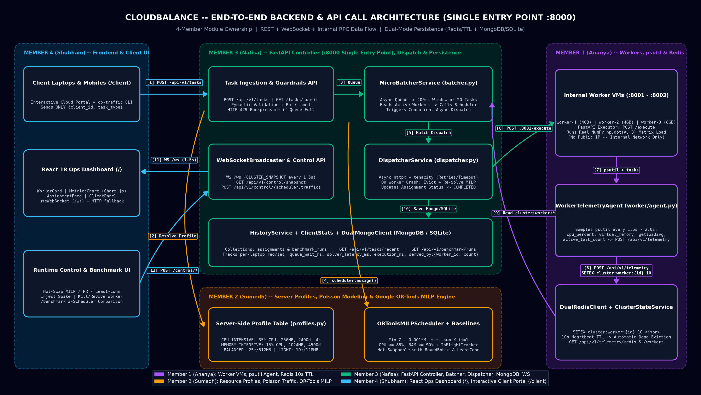

# Member 3 (Nafisa) — FastAPI Backend, API Architecture, Micro-Batcher, Dispatcher, WebSockets & MongoDB Guide

**Role:** Module 3 — Central FastAPI Controller (`:8000` Single Public Entry Point), REST APIs, Micro-Batching, Internal Worker Dispatch & Failover, WebSocket Broadcaster, and MongoDB/SQLite Persistence  
**Technologies:** Python 3.11, FastAPI, Uvicorn, Pydantic v2, `httpx`, `tenacity`, WebSockets, MongoDB (`motor` + `SQLiteFallbackStore`), `structlog`



---

## 1. Scope & Responsibilities in the Current Build

Member 3 owns the **Central Nervous System & Communication Layer** of CloudBalance. Every component in the project—Member 1's `psutil` worker agents and Redis store, Member 2's OR-Tools MILP scheduler and traffic generator, and Member 4's React Dashboard and `/client` portal—connects through Member 3's FastAPI Controller on port `:8000`.

Your exact responsibilities in the codebase are:
1. **Single Public Entry Point & Application Lifecycle (`backend/app/main.py`, `backend/run_cluster.py`)**: FastAPI app factory, async `lifespan` startup/shutdown of database clients, micro-batcher, and WebSocket broadcaster, CORS middleware, `X-Correlation-ID` tracing middleware, and serving the compiled React SPA (`/` and `/client`) directly from port `:8000`.
2. **Strict Data Contracts (`backend/app/models/schemas.py`)**: Immutable Pydantic v2 models validating every inbound request and outbound response (`TaskRequest`, `Task`, `Telemetry`, `Assignment`, `ClusterSnapshot`, `ClientStats`, `BenchmarkRun`).
3. **REST & WebSocket API Layer (`backend/app/api/*`)**:
   - `tasks.py`: Task submission (`POST /api/v1/tasks`, `GET /api/v1/tasks/submit`), token-bucket rate limiting, HTTP 429 queue backpressure, recent tasks (`GET /api/v1/tasks/recent`), and profiles (`GET /api/v1/tasks/profiles`).
   - `control.py`: Runtime scheduler hot-swap (`POST /api/v1/control/scheduler`), traffic spike injection & pause (`POST /api/v1/control/traffic`), worker kill/revive simulation (`POST /api/v1/control/workers/{id}/kill|revive`), and HTTP snapshot fallback (`GET /api/v1/control/snapshot`).
   - `websocket.py` & `broadcaster.py`: Real-time `WS /ws` streaming `CLUSTER_SNAPSHOT` every 1.5 seconds to all connected browsers.
   - `health.py` & `benchmark.py`: Liveness/readiness probes (`/health`, `/ready`) and benchmark APIs (`/api/v1/benchmark/runs`).
4. **Micro-Batching & Internal Dispatch Engine (`backend/app/services/batcher.py`, `dispatcher.py`)**: Queuing inbound tasks, flushing micro-batches every `200ms` (or `20` tasks), invoking the scheduler, dispatching `POST http://<worker_ip>:8001/execute` over async `httpx` with `tenacity` retries, and automatically re-solving onto healthy workers if a worker VM fails.
5. **Persistent History & Per-Client Analytics (`backend/app/core/mongo_client.py`, `backend/app/services/history.py`, `client_stats.py`)**: Storing task assignments and benchmark runs in MongoDB (with automatic `SQLiteFallbackStore` in local mode) and tracking per-laptop request rates and `served_by` worker distributions.

---

## 2. Exact Files Owned by Member 3

| File Path | Key Classes / Functions | Purpose |
| :--- | :--- | :--- |
| [`backend/app/main.py`](file:///c:/Users/sumed/Desktop/CLOUD%20BALANCE/backend/app/main.py) | `create_app()`, `lifespan()` | FastAPI app factory, middleware, router registration, and SPA static mount. |
| [`backend/run_cluster.py`](file:///c:/Users/sumed/Desktop/CLOUD%20BALANCE/backend/run_cluster.py) | `main()` | Single-command launcher starting 3 real internal workers (`:8001–8003`) + Controller (`:8000`). |
| [`backend/app/models/schemas.py`](file:///c:/Users/sumed/Desktop/CLOUD%20BALANCE/backend/app/models/schemas.py) | `TaskRequest`, `Task`, `Assignment`, `ClusterSnapshot`, `ClientStats` | Strict Pydantic v2 schemas (`frozen=True`) and mobile `client_id` sanitization. |
| [`backend/app/api/tasks.py`](file:///c:/Users/sumed/Desktop/CLOUD%20BALANCE/backend/app/api/tasks.py) | `submit_task()`, `submit_task_get()`, `get_recent_tasks()` | Task ingestion, rate limiting, HTTP 429 backpressure, and recent task queries. |
| [`backend/app/api/control.py`](file:///c:/Users/sumed/Desktop/CLOUD%20BALANCE/backend/app/api/control.py) | `switch_scheduler()`, `control_traffic()`, `kill_worker_node()`, `revive_worker_node()` | Runtime control endpoints for live scheduler hot-swapping, burst spikes, and worker failover demos. |
| [`backend/app/api/websocket.py`](file:///c:/Users/sumed/Desktop/CLOUD%20BALANCE/backend/app/api/websocket.py) & [`services/broadcaster.py`](file:///c:/Users/sumed/Desktop/CLOUD%20BALANCE/backend/app/services/broadcaster.py) | `websocket_endpoint()`, `WebSocketBroadcaster` | Manages connected WebSocket clients and broadcasts `CLUSTER_SNAPSHOT` every 1.5s. |
| [`backend/app/services/batcher.py`](file:///c:/Users/sumed/Desktop/CLOUD%20BALANCE/backend/app/services/batcher.py) | `MicroBatcherService` | Async task queue + 200ms / 20-task micro-batching loop coordinating Redis, Scheduler, and Dispatcher. |
| [`backend/app/services/dispatcher.py`](file:///c:/Users/sumed/Desktop/CLOUD%20BALANCE/backend/app/services/dispatcher.py) | `DispatcherService` | Sends `POST http://<worker>:8001/execute` with retries, timeouts, and automatic failover re-solving. |
| [`backend/app/services/history.py`](file:///c:/Users/sumed/Desktop/CLOUD%20BALANCE/backend/app/services/history.py) & [`client_stats.py`](file:///c:/Users/sumed/Desktop/CLOUD%20BALANCE/backend/app/services/client_stats.py) | `HistoryService`, `ClientStatsService` | Records assignments to MongoDB/SQLite + Redis and tracks per-client sliding-window `req_per_sec` and `served_by` counts. |
| [`backend/app/core/mongo_client.py`](file:///c:/Users/sumed/Desktop/CLOUD%20BALANCE/backend/app/core/mongo_client.py) | `DualMongoClient`, `SQLiteFallbackStore` | Async Motor MongoDB client with automatic SQLite fallback for local zero-cloud execution. |
| [`backend/app/core/config.py`](file:///c:/Users/sumed/Desktop/CLOUD%20BALANCE/backend/app/core/config.py) & [`security.py`](file:///c:/Users/sumed/Desktop/CLOUD%20BALANCE/backend/app/core/security.py) | `Settings`, `verify_api_key()`, `TokenBucketRateLimiter` | 12-factor environment configuration (`CB_*`), constant-time API key auth, and token-bucket rate limiter. |

---

## 3. Complete Backend API Reference Table (All Endpoints on `:8000`)

| Category | Method | Endpoint Path | Request Body / Query Params | Response Status & Purpose |
| :--- | :---: | :--- | :--- | :--- |
| **Task Ingestion** | `POST` | `/api/v1/tasks` | `{"client_id": "laptop-alpha", "task_type": "CPU_INTENSIVE"}` | `202 Accepted` (or `429` if queue full). Resolves server profile, queues task, caches in Redis. |
| **Task Ingestion (Mobile Fallback)** | `GET` | `/api/v1/tasks/submit` | `?client_id=mobile-1&task_type=BALANCED_COMPUTE` | `202 Accepted`. Idempotent fallback if mobile hotspot resets a keep-alive `POST` socket. |
| **Task History** | `GET` | `/api/v1/tasks/recent` | `?limit=20&client_id=laptop-alpha` | `200 OK`. Returns recent `Assignment` records from History / MongoDB / SQLite. |
| **Resource Profiles** | `GET` | `/api/v1/tasks/profiles` | *(none)* | `200 OK`. Returns server-side `TASK_PROFILES` table. |
| **Worker Telemetry** | `POST` | `/api/v1/telemetry` | `Telemetry` JSON from worker `psutil` agent | `200 OK`. Writes `SETEX cluster:worker:{id} 10 <json>` in Redis. |
| **Active Workers** | `GET` | `/api/v1/telemetry/workers` | *(none)* | `200 OK`. Returns active `WorkerSnapshotItem`s with live + in-flight load. |
| **Redis Inspector** | `GET` | `/api/v1/telemetry/redis` | *(none)* | `200 OK`. Dumps all live `cluster:*` keys and their TTLs from Redis. |
| **Scheduler Hot-Swap** | `POST` | `/api/v1/control/scheduler` | `{"scheduler": "ortools_milp" \| "round_robin" \| "least_connections"}` | `200 OK`. Switches active scheduler immediately at runtime without restart. |
| **Traffic Control & Spike** | `POST` | `/api/v1/control/traffic` | `{"lambda_rate": 12, "paused": false, "spike_tasks": 15, ...}` | `200 OK`. Updates global $\lambda$, pauses/resumes batcher, or injects an instant burst spike. |
| **Simulate Worker Crash** | `POST` | `/api/v1/control/workers/{id}/kill` | Path param `worker_id` (e.g. `worker-2`) | `200 OK`. Evicts worker key from Redis and blocks heartbeats to demonstrate failover. |
| **Revive Worker** | `POST` | `/api/v1/control/workers/{id}/revive` | Path param `worker_id` (e.g. `worker-2`) | `200 OK`. Restores killed worker back into the active cluster pool. |
| **Snapshot Fallback** | `GET` | `/api/v1/control/snapshot` | *(none)* | `200 OK`. Returns the complete `ClusterSnapshot` JSON over HTTP. |
| **Live WebSocket** | `WS` | `/ws` | Bi-directional WebSocket (`"ping"` $\rightarrow$ `{"type": "PONG"}`) | Streams `CLUSTER_SNAPSHOT` JSON every 1.5s and immediately on control events. |
| **Benchmark API** | `GET / POST` | `/api/v1/benchmark/runs` & `/run` | Optional `?tasks_per_client=20` | Returns stored 3-scheduler comparison runs from MongoDB/SQLite or triggers a fresh run. |
| **Health Probes** | `GET` | `/health` and `/ready` | *(none)* | `200 OK`. Reports liveness and Redis/MongoDB backend modes (`in_memory_ttl` / `sqlite_fallback`). |

---

## 4. Deep Dive: How Micro-Batching & Failover Dispatch Work Together

### A. Why Micro-Batching (`MicroBatcherService` in `backend/app/services/batcher.py`)?
If 3 laptops send 15 requests within 200ms and the backend scheduled them one by one (`batch_size = 1`), the scheduler could not optimize across the mix of tasks (e.g., pairing a `CPU_INTENSIVE` task with a `MEMORY_INTENSIVE` task on different servers).
- `MicroBatcherService` collects incoming tasks in an `asyncio` queue for up to **200ms** (or **20 tasks**, whichever comes first).
- In `flush_one_batch()`:
  1. Pops up to 20 tasks from `self._queue`.
  2. Fetches all live workers via `await self._cluster_state.get_active_workers()`.
  3. Calls `scheduler.assign(batch_tasks, workers, record_in_flight=True)`.
  4. Persists initial `ASSIGNED` records via `HistoryService` and `ClientStatsService`.
  5. Launches concurrent non-blocking `asyncio.create_task(self._dispatcher.dispatch_task(...))` calls to the assigned worker VMs.

### B. How Automatic Failover Works (`DispatcherService` in `backend/app/services/dispatcher.py`)
```python
try:
    exec_ms = await self._post_to_worker(initial_worker, payload)
    scheduler.in_flight.release(task.task_id)
    updated = self._history.update_assignment_status(
        task_id=task.task_id, status="COMPLETED", execution_ms=exec_ms,
        assigned_worker_id=initial_worker.worker_id,
    )
    await self._history.sync_assignment_to_redis(updated)
except Exception as exc:
    # 1. Release reservation on failed worker and evict from Redis immediately
    scheduler.in_flight.release(task.task_id)
    await self._cluster_state.evict_worker(initial_worker.worker_id)
    # 2. Re-solve using active scheduler across remaining healthy workers
    remaining = [w for w in candidate_workers if w.worker_id != initial_worker.worker_id ...]
    failover_res = scheduler.assign([task], remaining, record_in_flight=True)
    new_worker = ...
    # 3. Dispatch to new worker and mark COMPLETED
    exec_ms = await self._post_to_worker(new_worker, payload)
```
When a worker fails (even mid-flight), the client never sees an error: the Controller catches the connection/HTTP error after retrying with `tenacity`, evicts the dead worker from Redis, re-runs the scheduler across the surviving workers, and completes the task transparently.

---

## 5. Top Viva Questions & Answers for Member 3

1. **Q: Why do clients only send `{client_id, task_type}` instead of specifying CPU and RAM in the POST body?**  
   **A:** Security and architectural decoupling. External clients shouldn't know or be trusted to declare internal server resource costs. The Controller maps `task_type` to its own server-side profile table (`profiles.py`), ensuring schemas stay locked and clients cannot spoof resource demands.
2. **Q: What is the difference between what Redis stores vs. what MongoDB/SQLite stores?**  
   **A:** Redis is the **hot-path ephemeral state store** (holding `cluster:worker:{id}` with a 10s TTL and recent task/assignment cache with a 60s TTL for sub-millisecond scheduling lookups). MongoDB (with `SQLiteFallbackStore` locally) is the **cold-path persistent history store** (holding the `assignments` audit log and `benchmark_runs` for historical analysis and dashboard tables).
3. **Q: How does the backend protect itself if 10 laptops flood it with 10,000 requests per second?**  
   **A:** Two guardrails in `backend/app/api/tasks.py`: (1) `TokenBucketRateLimiter` enforces a configurable requests-per-second rate limit with burst capacity, and (2) `batcher.is_queue_full` checks if the queue has reached `max_queue_depth` (default 500) and immediately sheds excess load with `HTTP 429 Too Many Requests` (backpressure) before memory can be exhausted.

